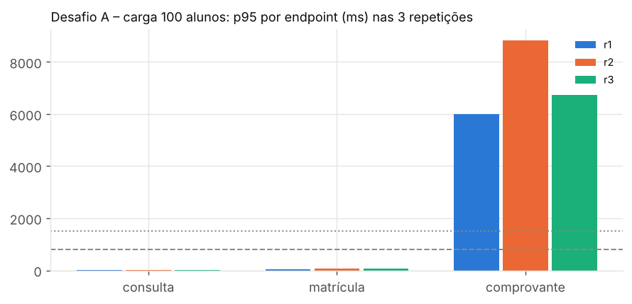
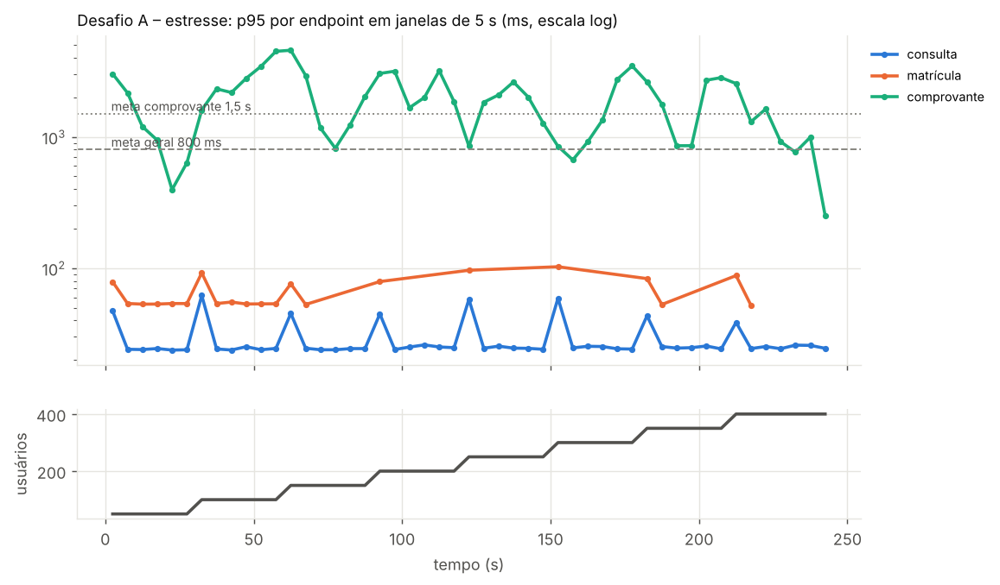
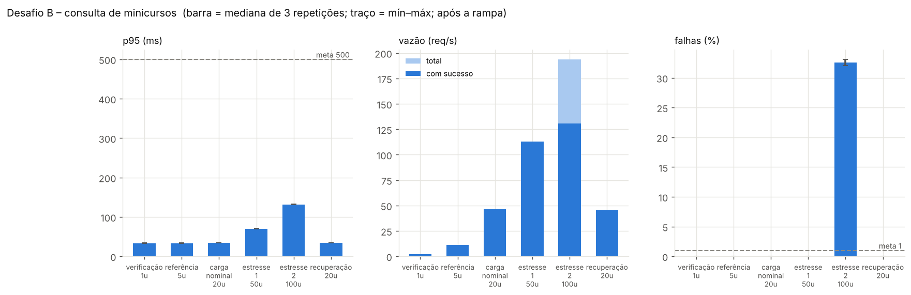
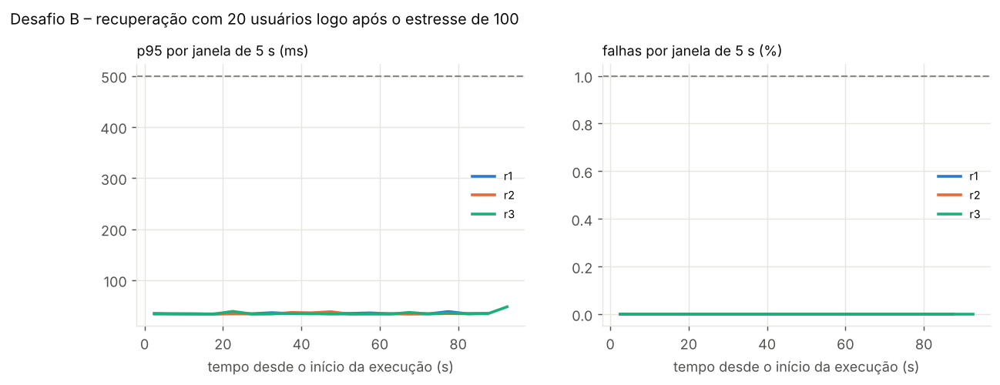
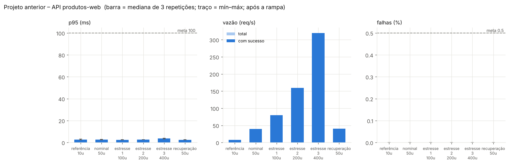

**Equipe:** Luiz Felipe de Lima Silva Tavares da Costa e Samuel Alves de Sousa · **Data das execuções:** 17/11/2026 · **Linguagem/ferramenta:** Python 3.13 + Locust 2.47

## 1. Ambiente e método

| Item | Valor |
|---|---|
| Máquina | VM Intel Xeon 2,1 GHz, **2 vCPU**, 7,8 GB RAM, Ubuntu 24.04.5 |
| Sistemas | A: Flask 3.1 (servidor de desenvolvimento, `threaded=True`); B: `ThreadingHTTPServer` (biblioteca padrão); projeto: Node 22 + Express 5 |
| Gerador | Locust 2.47.0, 1 processo, **na mesma máquina** dos sistemas (sem rede entre eles) |
| Banco | Nenhum: os três sistemas guardam os dados em memória |

**O que foi medido e como.** Cada script verifica status **e** conteúdo (não só tempo) e grava, além
das saídas padrão do Locust, um arquivo `_requisicoes.csv` com uma linha por requisição. Com ele o
script `ferramentas/analisar.py` calcula o **patamar** (só as requisições depois da rampa
`usuários ÷ r`) e séries em janelas de 5 s. Nas tabelas, "agregado" é o número do próprio Locust
(inclui a rampa) e "patamar" é o recorte após a rampa. Todos os números deste relatório estão em
`resultados/registro_resultados.csv` e `resultados/resumo_analise.json`; o texto marcado
**Interpretação** é análise nossa.

## 2. Pacote A – Sabor Express e Matrícula

### 2.1 Exemplo resolvido – Semana do Cliente

Rodamos o script do professor sem alterações (carga 50 usuários/2 min e estresse 25→250 em degraus de 30 s).

| Teste | Requisições | p95 agregado | Erros | p95 `relatorio/vendas` (meta 2 s) | Resultado do script |
|---|---|---|---|---|---|
| Carga 50u | 2.772 | 71 ms | 0% | 210 ms | APROVADO |
| Estresse 25→250u | 18.984 | 35 ms | 0% | **13.000 ms** (máx. 17,2 s) | REPROVADO |

Comparação com os relatórios de referência do professor (`resultados-exemplo/carga.html` e `estresse.html`):

| Teste | Referência: req. / p95 agregado / p95 relatório | Nossa execução: req. / p95 agregado / p95 relatório |
|---|---|---|
| Carga 50u | 2.805 / 70 ms / 190 ms | 2.772 / 71 ms / 210 ms |
| Estresse 25→250u | 18.917 / 36 ms / 13.000 ms | 18.986 / 35 ms / 13.000 ms |

Os números ficaram muito próximos dos de referência, nos dois testes; o mesmo endpoint aparece como gargalo.

**Interpretação.** O agregado fica ótimo nos dois testes porque cardápio e pedidos dominam o volume; quem
reprova é o **relatório de vendas**, gargalo do exemplo: trava global + custo que cresce com o número de
pedidos (`0,05 s + 0,2 ms × pedidos`). No estresse, quanto mais pedidos acumulam, mais lento fica cada
relatório e todos esperam na mesma trava. Lição levada para o desafio: **olhar cada endpoint, não só o agregado.**

### 2.2 Desafio A – Abertura da matrícula

Plano completo em `pacote-A/desafio/plano_desafio_A.md`. Resumo: jornada consulta (peso 6) / matrícula
(peso 3, seguida do download do comprovante) / comprovante (peso 1); um aluno diferente por usuário virtual;
combinações de 2–4 disciplinas sem choque, escolhidas entre as que o aluno viu com vaga; 409/422 contados
como regra de negócio; checagem de vagas ≥ 0 em toda consulta e de integridade ao final
(vagas consumidas = matrículas 201 por disciplina). Metas: p95 geral ≤ 800 ms, p95 comprovante ≤ 1,5 s,
erro técnico < 1%. Hipótese do plano: o comprovante (geração de PDF simulada) seria o gargalo.

| Execução | Req. | Vazão | p95 geral | p95 comprovante | Erro técnico | 201 / 409 vagas / desistências | Vagas | SLA |
|---|---|---|---|---|---|---|---|---|
| Carga 100u r1 | 4.333 | 36,1 req/s | 2.800 ms | 5.900 ms | 0% | 92 / 42 / 8 | íntegras, mín. 0 | **não atende** |
| Carga 100u r2 | 4.281 | 35,6 req/s | 1.800 ms | 8.800 ms | 0% | 95 / 35 / 5 | íntegras | **não atende** |
| Carga 100u r3 | 4.327 | 36,0 req/s | 1.600 ms | 6.700 ms | 0% | 94 / 30 / 6 | íntegras | **não atende** |
| Pico 0→200u r1 | 5.157 | 51,5 req/s | 1.500 ms | 11.000 ms | 0% | 96 / 159 / 104 | íntegras | **não atende** |
| Pico 0→200u r2 | 5.288 | 52,8 req/s | 1.200 ms | 9.100 ms | 0% | 98 / 197 / 102 | íntegras | **não atende** |
| Pico 0→200u r3 | 5.352 | 53,4 req/s | 250 ms | 11.000 ms | 0% | 95 / 171 / 105 | íntegras | **não atende** (comprovante) |
| Estresse 50→400u | 21.332 | 88,8 req/s | 59 ms | 3.100 ms | 0% | 93 / 151 / 279 (+28 "já possui") | íntegras | **não atende** (comprovante) |

p95 por endpoint no patamar da carga (após 5 s de rampa), mediana das 3 repetições:
**consulta 24 ms · matrícula 55 ms · comprovante 6.741 ms** (r1 6.010, r2 8.819, r3 6.741).

| Degrau do estresse (5 s de transição descartados) | 50u | 100u | 150u | 200u | 300u | 400u |
|---|---|---|---|---|---|---|
| Consulta: p95 / vazão | 24 ms / 17 r/s | 24 / 32 | 24 / 54 | 25 / 74 | 25 / 115 | 25 / 154 |
| Comprovante: p95 / vazão | **1.916 ms** / 2,6 r/s | 4.031 / 4,0 | 2.819 / 3,7 | 3.133 / 3,7 | 3.210 / 3,6 | 1.361 / 3,6 |

**Respostas às perguntas do roteiro.**

- **O SLA foi atendido?** Não, em nenhum dos três tipos. O erro técnico ficou em 0% e as vagas
  ficaram íntegras em todas as 7 execuções (nenhuma negativa; consumo = matrículas 201), mas o
  p95 do comprovante violou 1,5 s em todas, e o p95 geral violou 800 ms nas 3 cargas e em 2 dos 3 picos.
- **Qual endpoint piora primeiro e a partir de quantos alunos?** O **comprovante**, já no primeiro
  degrau de **50 alunos** (p95 1,9 s). A vazão dele para em **~4 req/s** a partir de 100 alunos e não
  passa disso, enquanto a consulta cresce linearmente até 154 req/s com p95 estável em 25 ms.
  A matrícula (POST) ficou abaixo de 105 ms em todos os testes.
- **Interpretação.** 4 req/s é exatamente `1 ÷ 0,25 s`: o comprovante passa por uma trava global
  (`_lock_pdf`) que serializa uma geração de 250 ms – só um aluno por vez gera o PDF. Toda matrícula
  bem-sucedida dispara um download logo depois, então a abertura produz uma fila: ~95 comprovantes
  pedidos nos primeiros segundos levam ≥ 24 s para serem atendidos. Como o comprovante é 5–10% das
  requisições, o p95 *geral* oscila conforme a fatia dele passa ou não de 5% (por isso o pico r3 ficou
  em 250 ms e o r1 em 1.500 ms com o mesmo comportamento) – mais uma razão para a meta por endpoint.
  O servidor nunca recusou requisições (0 erros): com threads ilimitadas, a sobrecarga vira espera, não 5xx.
  O critério de parada (erros > 20% ou p95 > 10 s por 10 s) não foi atingido até 400 alunos.
- **Pico e volta.** Durante o pico (0–70 s) o comprovante teve p95 de 9–11 s; depois da queda para 20
  alunos ele voltou a 254–464 ms (poucas amostras: 7–14 por repetição). Ver `A_pico_por_endpoint.png`.
- **Melhoria recomendada.** Tirar a geração do PDF do caminho crítico: gerar o comprovante uma vez,
  em segundo plano, no momento da matrícula (fila + worker, ou pool de N geradores no lugar da trava
  única) e servir o arquivo pronto (cache). Com N geradores a vazão sobe para N × 4 req/s. Também vale
  responder `202 Accepted` com link quando o PDF ainda não estiver pronto.

**Investigação de concorrência (fora do roteiro).** Ao ler o fluxo de `POST /api/matriculas`
suspeitamos que a regra R6 (matrícula única) é checada **fora** da trava de vagas. O script
`ferramentas/teste_corrida_matricula.py` envia 20 matrículas simultâneas do mesmo aluno:
em **5 de 5 tentativas** o resultado foi o correto (1 × 201, 19 × 409, ES3 com 39 vagas) –
saída em `resultados/pacote-A/corrida_matricula.txt`. **Hipótese não confirmada:** a janela entre a
checagem e a trava é curta demais para aparecer com o GIL do Python neste servidor. Registramos como
risco de código (a checagem deveria ficar dentro da mesma trava), não como defeito comprovado.

## 3. Pacote B – Biblioteca e Minicursos

### 3.1 Exemplo resolvido – Catálogo

20 leitores, 90 s: **3.915 requisições, p95 36 ms, 43,9 req/s, 0 falhas → atende** (p95 ≤ 500 ms, falhas ≤ 1%).
O Locust 2.47 imprimiu um `ValueError: I/O operation on closed file` **depois** de gravar os CSV, no
encerramento: é um problema do gravador de CSV da ferramenta, não do teste (os arquivos estão completos).

### 3.2 Desafio B – Consulta de minicursos

Plano em `pacote-B/desafio/plano_desafio_B.md`. Proporção obtida na carga: 69,8% / 30,2% (r1),
70,5% / 29,5% (r2), 69,8% / 30,2% (r3) – próxima dos 70/30 esperados.

| Fase (patamar após a rampa; mediana de 3 repetições, mín–máx) | p95 | Vazão total | Falhas | Meta |
|---|---|---|---|---|
| Verificação 1u | 33–34 ms | 2,3–2,5 req/s | 0% | atende ×3 |
| Referência 5u | 33–34 ms | 11,5–11,7 | 0% | atende ×3 |
| **Carga nominal 20u** | **34–35 ms** | **46,1–46,5** | **0%** | **atende ×3** |
| Estresse 50u | 70–71 ms | 112,5–112,8 | 0,00–0,02% | atende ×3 |
| Estresse 100u | 132 ms | 192,8–195,6 (só ~130 com sucesso) | **32,0–33,1%** | **não atende ×3** – parada em t = 25–26 s |
| Recuperação 20u | 34–35 ms | 45,8–46,1 | 0% | atende ×3 |

**Interpretação.**

- **Primeiro patamar que viola a meta: 100 usuários**, nas 3 repetições, por falhas (HTTP 503
  "Capacidade didática ocupada"), não por tempo. O critério de parada interrompeu as 3 execuções
  em t = 25–26 s (falhas de 32–33% por 10 s).
- **A vazão parou de crescer.** De 50 para 100 usuários a vazão **com sucesso** foi de ~113 para ~130 req/s,
  bem perto do limite teórico `4 vagas ÷ 0,03 s ≈ 133 req/s`: o excedente vira 503 rápido (o servidor
  espera só 0,1 s por uma vaga), por isso o p95 sobe pouco (132 ms) enquanto as falhas disparam.
  A hipótese do plano (primeira violação entre 50 e 100) se confirmou.
- **Recuperação:** com 20 usuários logo após o estresse, todas as janelas de 5 s ficaram dentro da
  meta desde a primeira (p95 ~35 ms, 0 falhas) nas 3 repetições: **voltou em menos de 5 s (meta 30 s)**.
  Limitação: cada fase é um processo novo do Locust, e o servidor não acumula fila (rejeita com 503
  em vez de enfileirar); por isso a recuperação é praticamente imediata e o teste não mede um
  eventual "rastro" do estresse dentro da mesma execução.
- **Repetições:** muito parecidas (p95 variou ≤ 2 ms e a vazão ≤ 1% entre repetições), porque o tempo
  é dominado pela latência artificial fixa de 30 ms.

## 4. Projeto anterior – API do *produtos-web*

Sistema de Programação para Internet II (github.com/luizfelipettavares/produtos-web): tela React + API
REST Express 5 em Node 22, dados em memória. Plano com metas próprias em `projeto-anterior/plano_projeto.md`.

**Operação e metas (justificadas no plano).** `GET /api/products` é a chamada que a tela faz ao abrir.
Meta: com **50 usuários** (uma turma inteira abrindo o link ao mesmo tempo, com folga), **p95 ≤ 100 ms**
(limite de resposta "instantânea" em usabilidade; a operação não faz I/O, então tempo acima disso
indicaria fila) e **falhas ≤ 0,5%** (leitura não tem motivo de negócio para recusar). Mistura:
listar 5 · buscar 3 · buscar com estoque 1 · categorias 1, com verificação de conteúdo (6 itens; busca só
devolve nomes que contêm o termo; `inStock=true` sem itens em falta; categorias = [Frutas, Verduras]).

| Fase (60 s, patamar após a rampa, 3 repetições) | p95 | Vazão | Falhas | Meta |
|---|---|---|---|---|
| Referência 10u | 2–3 ms | 7,8–8,1 req/s | 0% | atende ×3 |
| **Nominal 50u** | **2–3 ms** | **39,8–40,0** | **0%** | **atende ×3** |
| Estresse 100u | 2–3 ms | 79,5–80,4 | 0% | atende ×3 |
| Estresse 200u | 3 ms | 158,9–159,7 | 0% | atende ×3 |
| Estresse 400u | 3–4 ms | 318,6–319,7 | 0% | atende ×3 |
| Recuperação 50u | 2–3 ms | 39,6–40,6 | 0% | atende ×3 |
| Exploratório 1000u (1 execução, fora do plano) | 8 ms | 796 | 0% | atende |

**Interpretação.** **O limite não foi atingido até 400 usuários** (nem no degrau exploratório de 1000): a
vazão cresceu na mesma proporção dos usuários (≈ 0,8 req/s por usuário, o que o think time de 0,5–2 s
prevê) e o p95 ficou abaixo de 10 ms em tudo. A recuperação é imediata (primeira janela de 5 s já dentro
da meta nas 3 repetições), mas pelo mesmo motivo não é informativa: o sistema nunca saiu da meta.
A hipótese do plano se confirmou em parte: nesta máquina o que limita o teste é o **gerador** (um processo
Locust disputando 2 vCPU), não a API – para achar o limite real seria preciso Locust distribuído
(`--processes`) ou outra máquina. As repetições variaram no máximo 1 ms no p95 e 1% na vazão.
**Recomendação:** a API já sobra para o uso previsto; o risco maior está no deploy: se a API ficar num plano gratuito que
hiberna sem uso, a 1ª chamada demora – a tela já trata a falha caindo para os dados locais. Não fizemos
teste de carga contra os endereços publicados (proibido pelo roteiro).

## 5. Limitações

- Servidor e gerador na **mesma VM de 2 vCPU**: no estresse o Locust disputa CPU com o sistema;
  números absolutos valem para esta máquina, as comparações entre patamares valem mais que os valores.
- Servidores de desenvolvimento (Flask dev server, `ThreadingHTTPServer`, Node sem cluster), sem banco:
  não estimam capacidade de produção. No Pacote B a latência e o limite são artificiais (do roteiro).
- Estresse do Pacote A com 1 repetição (carga e pico com 3). Acima de 200 usuários virtuais os
  números de aluno se repetem (só existem 200), o que gera 409 "já possui" – contado como negócio.
- A mistura de tarefas é probabilística: a proporção exata varia por execução (conferida acima).
- Durante a 1ª fase do projeto (referência 10u, r1) rodamos a análise em baixa prioridade (`nice 19`);
  essa fase foi refeita depois e a versão registrada é a refeita.

## 6. Contribuição dos integrantes

| Integrante | Código | Execução/análise | Relatório/slides |
|---|---|---|---|
| Luiz Felipe de Lima Silva Tavares da Costa | Exemplo A e Desafio A (`locustfile_matricula.py`: jornadas, 409/422, integridade das vagas, perfis carga/pico/estresse); teste de corrida da matrícula | Execuções do Pacote A (carga ×3, pico ×3, estresse); análise do gargalo do comprovante | Seções 1 e 2 do relatório; slides do problema, do código e dos resultados do Pacote A |
| Samuel Alves de Sousa | Exemplo B e Desafio B (`desafio_locust.py`: tarefas 70/30, verificações, critério de parada); `locustfile_produtos.py` do projeto anterior; `analisar.py` (tabelas e gráficos) | Execuções do Pacote B (6 fases ×3) e do projeto (6 fases ×3 + exploratório); análise de patamares e recuperação | Seções 3, 4 e 5 do relatório; slides de conceitos, conclusões e apêndices |

Os dois integrantes revisaram o relatório e os slides inteiros e ensaiaram a apresentação juntos.
